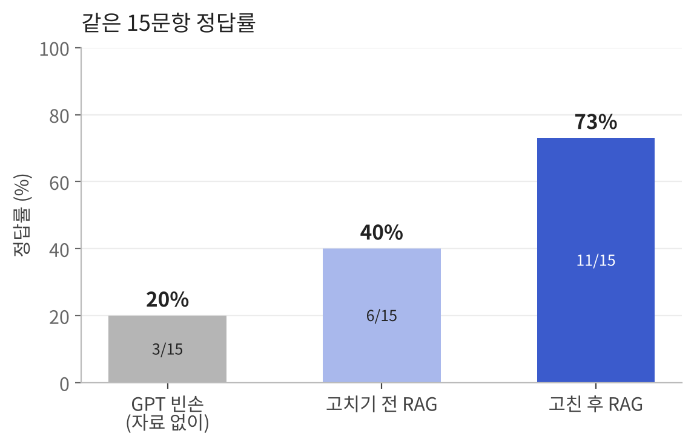
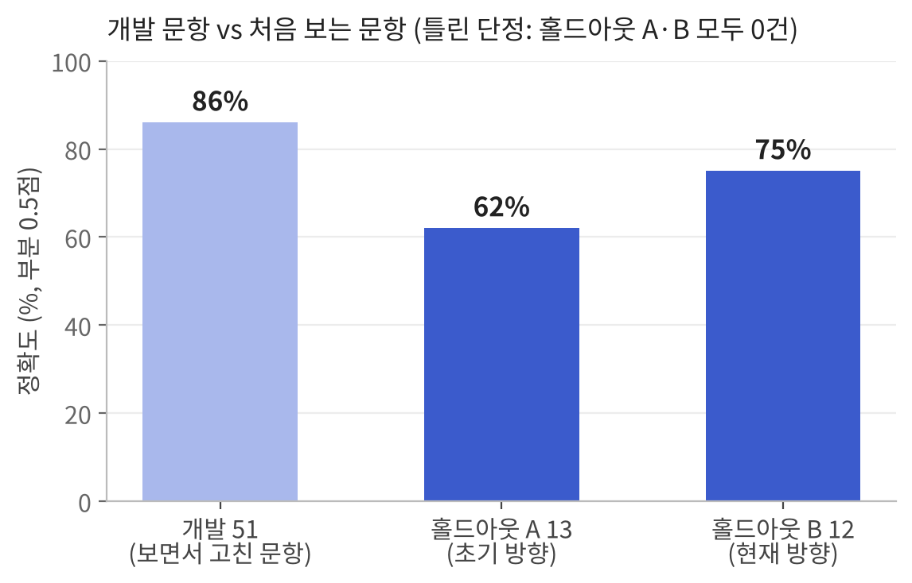
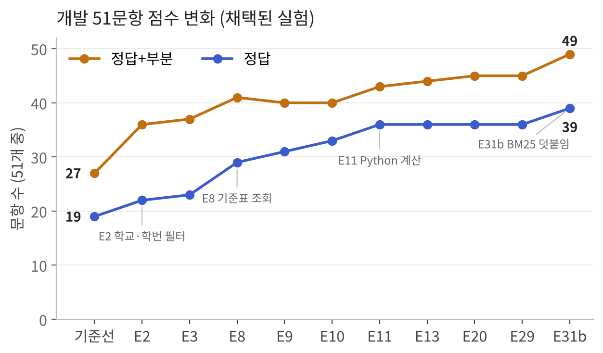

# 대전 지역 대학 졸업요건 안내 서비스: 학칙을 근거로 답하고, 틀린 곳을 찾아 고친 기록

작성일 2026-11-12. 대전 5개 대학(배재·충남·한남·한밭·목원)의 학칙·시행세칙을 근거로 졸업요건과 학사 규정을 안내하는 RAG 서비스를 만들고, 일반 AI가 틀리는 곳과 우리 서비스가 틀리는 곳을 찾아 고친 과정을 정리한 최종 리포트다. 숫자는 모두 저장소의 기록(`eval/experiments.md`, `CLAUDE.md`, 결과 파일)에서 가져왔다. 정확도는 1차 프로젝트와 같이 정답 1점, 부분 0.5점으로 계산했고, 정답 개수도 함께 적었다.

## 0. 한 장 요약

**문제.** 졸업요건은 학교·학번·학과마다 다르고, 정보가 학교 포털과 규정집 여러 곳에 흩어져 있다. 졸업 필수 과목 하나를 놓쳐 한 학기를 더 다니는 경우도 생긴다. 일반 AI에 물으면 다른 학교의 숫자를 섞어 말하거나, 근거 없이 단정한다.

**만든 것.** 학교·학번·학과만 고르면 졸업학점과 교양·전공 기준을 바로 보여 주고(내 졸업요건), 부전공과 복수전공의 전공학점을 계산해 비교하며(학사 선택 비교), 화면에 없는 규칙은 학칙 조항을 근거로 답하는(규정 질문) Streamlit 서비스다. 배재대 IT경영정보학과는 이번 학기 개설 과목까지 연결했다(시범). 근거가 없으면 지어내지 않고 "확인 불가"로 답한다.

**한 일.** 평가셋을 만들어 틀린 문항을 원인별로 나누고, 원인마다 고쳐서 점수를 다시 쟀다. 마지막에는 코드를 동결하고 처음 보는 문항(홀드아웃)으로 한 번만 측정했다.

| 같은 15문항 정답률 | GPT 빈손 | 고치기 전 RAG | 고친 후 RAG |
|---|---|---|---|
| 정답 / 15 | 3 | 6 | 11 |
| **정답률** | **20%** | **40%** | **73%** |
| 틀린 내용을 단정한 답 | 6 | 2 | **0** |

| 답변 정확도 (정답 1, 부분 0.5) | 고치기 전 (개발 51) | 고친 후 (개발 51) | 홀드아웃 A (13) | 홀드아웃 B (12) |
|---|---|---|---|---|
| 정답·부분·나머지 | 19·8·24 | 39·10·2 | 5·6·2 | 9·0·3 |
| **점수** | **45%** | **86%** | **62%** | **75%** |
| 틀린 내용을 단정한 답 | 6 | 2 이하 | **0** | **0** |

- 홀드아웃 A·B 모두 **틀린 내용을 단정한 답은 0건**이다. 정답을 못 받은 문항은 조건 일부를 빠뜨렸거나(A 부분 6), 규정에 답이 있는데 검색이 찾지 못해 "확인 불가"로 답한 경우(A 2, B 3)다.
- 범위 밖 질문(서비스에 없는 학교·학번)은 지어내지 않고 확인 불가로 답했다.
- 누적 API 비용: 약 $0.91 (토큰 비용 기준)
- 개발 51 고친 후의 틀린 단정 수는 따로 집계하지 않았다. 정답·부분이 아닌 문항이 2개라 2 이하다.

**배운 것 세 가지**

1. **개발 중에 본 문항의 점수는 낙관적이다.** 개발 문항 86%가 홀드아웃 A에서 62%, B에서 75%가 됐다. 1차(94~96% → 88.5%)보다 차이가 컸고, 그 이유를 7절에서 분석했다.
2. **학생의 말과 규정의 말은 다르다.** 놓친 문항 대부분은 "자퇴했다가 다시"(재입학), "졸업 미루기"(학사학위취득 유예)처럼 규정 용어가 질문에 없던 경우였다.
3. **출처끼리도 말이 다르다.** 같은 학교 안에서 세칙과 학과 공지가, 세칙 해설과 현행 규정 부칙이 서로 다른 값을 적은 경우가 있었다. 한쪽을 골라 단정하지 않고 "잠정"으로 표시하고 학과 확인을 안내했다.

## 1. 왜 만들었나

처음에는 내 입장에서 시작했다. 졸업 관련 정보가 학교 포털 여기저기에 흩어져 있어서 보기 불편했고, 주변에 졸업 필수 과목 하나를 안 들어서 한 학기를 더 다녀야 하는 사람을 봤다.

중간 피드백에서 "본인이 뭘 들었는지도 모르는 학생은 어떻게 쓰나"라는 질문을 받고 타겟을 **"졸업요건을 아직 아무것도 모르는 학생"**으로 다시 잡았다. 그래서 이수 학점을 넣지 않아도 학번과 학과만으로 졸업요건을 먼저 보여 주고, 학점 계산과 개설 과목 조회는 필요한 사람만 쓰도록 순서를 바꿨다.

### 일반 AI는 어디서 틀리나 (예비 확인)

학번·학과·신분에 따라 답이 달라지는 질문 10개(학점 5, 규정 5)를 학생이 바로 쓰는 조건, 즉 로그인하지 않은 무료 ChatGPT(웹 검색 사용, 2026년 11월 12일)에 묻고 답변을 학칙 원문과 대조했다. 질문마다 새 대화를 열고 한 번씩만 물었다. 10문항 중 4문항은 맞혔고, 아래 6문항에서 문제가 확인됐다.

| 질문 | ChatGPT 답 | 원문 | 확인된 문제 |
|---|---|---|---|
| 목원대 2022학번 정보통신공학과 졸업학점 몇이야? | 교양 17학점 자료만 찾고 "졸업학점은 확정하기 어려움" | 140학점 (시행세칙 2022학년도 표, 같은 해 다른 학과는 132) | 규정집 표 속 학과별 숫자를 못 찾음 |
| 목원대 2026학번 응급구조학과는 전공 몇 학점 들어야 돼? | "자료에서 찾지 못했어" | 전공 92학점 (시행세칙 2026학년도 표) | 규정집 표 속 학과별 숫자를 못 찾음 |
| 배재대 평점 4.3이면 한 학기에 몇 학점까지 신청할 수 있어? | "기준을 확정하기 어려워" | 21학점, 졸업학점 134·140·142 학과 3·4학년은 24학점 (시행세칙Ⅰ 제33조 ①) | 조건이 붙은 표를 못 찾음 |
| 충남대 학사경고 몇 번 받으면 제적돼? | "누적 제적 규정은 2013년에 폐지됐다" (위키 사이트 인용) | 연속 3회 성적경고 시 제적 (현행 학칙 제적 조항) | **있는 규정을 없다고 단정** |
| 한남대 2022학번인데 성적 안 좋은 과목 학점포기 할 수 있어? | 일반 학점포기 불가(2013학년도 이전만), "B 이하 성적은 재수강 가능" | 2015학년도 이후 재수강은 C·D·F만, 정당한 사유가 있으면 학장 신청 특례 (세칙 제75조의2) | 재수강 대상 오류, 특례 누락 |
| 충남대 전과하려면 기준 같은 거 있어? | 평점 2.5 이상, 학년별 이수학기·학점 | 편입생은 전과 불가, 재학 중 1회 (학칙 제52조 ⑤⑥) | 제한 조건 누락 |

웹 검색으로 찾기 쉬운 공지·안내 페이지의 내용(편입생 조기졸업 불가, 편입생 휴학 6학기 등)은 맞혔다. 반면 규정집 PDF 표 안에 있는 학번·학과별 숫자는 찾지 못했고, 위키 같은 비공식 자료를 근거로 현행 규정을 틀리게 말한 경우도 있었다.

이 확인은 웹 검색을 켠 ChatGPT 10문항의 예비 관찰이다. 답변은 화면 캡처로 확인했고, 결과 파일은 저장소에 남기지 않았다. 아래 "GPT 빈손"(자료 없이 gpt-6-luna에 물은 것)과는 다른 실험이다.

### GPT 빈손 테스트

개발 문항 중 15문항을 자료 없이 gpt-6-luna에 그대로 물었다.

| 조건 | 정답 / 15 |
|---|---|
| GPT 빈손 (gpt-6-luna, 자료 없이) | 3 (20%) |
| **우리 서비스 (고친 후)** | **11 (73%)** |

자료 없이 답한 GPT는 학교를 혼동했다. 배재대와 충남대 부전공 학점을 물었을 때 둘 다 한남대 값인 "21학점"을 단정했다(정답은 배재 제1전공 54 + 부전공 18, 충남 부전공 24 + 주전공 54).

## 2. 데이터

- **원문**: 5개 대학의 학칙, 학칙 시행세칙, 학사운영규정, 복수·부전공 규정, 교육과정 책자. 원문 PDF는 저장소에 올리지 않았다.
- **기준표 (`data/criteria.csv`)**: 졸업학점, 교양·전공 기준, 부전공·복수전공 학점, 편입 이수요건, 수강상한 등 숫자 기준을 학교·학번·학과 단위로 정리한 표. 학과 묶음 행(쉼표로 학과 나열)과 대학 기본 행·예외 행 구조로 만들었다. 행마다 근거 조항·쪽·출처 등급·상태(확정/잠정)를 적었다.
- **학과 범위 (2022~2026학번)**

학과 수는 실제 학과 기준이고, 계열·대학 단위 대체 선택지는 비고에 따로 적었다.

| 학교 | 학과 수 | 비고 |
|---|---|---|
| 배재 | 48 | |
| 목원 | 87 | 화면 선택지에는 계열·대학 단위 선택지 2개 추가 |
| 한남 | 59 | 정원외(외국인 전담) 학과 제외. 화면 선택지에는 계열·대학 단위 선택지 3개 추가 |
| 한밭 | 31 | 학과→계열은 단과대 기준 추정(잠정) |
| 충남 | 16 | 경영학부 중심. 전 학과 확장은 다음 과제 |

### 원문끼리 다른 경우

| 학교 | 내용 | 처리 |
|---|---|---|
| 한남 | 세칙은 "공학인증 운영학과 2023학번 이후 60학점", 학과 공지는 "2023학번부터 공학인증 해당 없음" | 잠정, 학과 확인 안내 |
| 목원 | 2022~2024학번 세칙 해설은 복수전공 36학점, 현행 복수전공 규정은 부칙으로 33학점 적용 | 현행 규정 값(33) 표시 + 해설 차이 안내 |
| 배재 | AI·SW창의융합대학의 2022~2024 표에 교양·졸업 칸이 비어 있음 | 해당 학과만 잠정, 학과 확인 안내 |

### 학과 이름이 바뀐 경우

2022학번 무역학과 학생은 지금 이름인 "무역물류학과"를 고른다. 옛 학번 행에는 옛 이름과 지금 이름을 둘 다 넣었다.

## 3. 시스템

### 화면

| 메뉴 | 하는 일 |
|---|---|
| 시작하기 | 사용법 안내 |
| 규정 질문 | 학칙·세칙을 근거로 답하고, 근거 조항·쪽을 카드로 보여 줌 |
| 내 졸업요건 | 학교·학번·학과만 고르면 졸업학점, 교양·전공 기준, 필수 과목. 이수 학점을 넣으면 남은 학점(선택) |
| 학사 선택 비교 | 부전공과 복수·다전공의 전공학점 합을 계산해 비교 |
| 이번 학기 개설 과목 | 배재 2026-2학기 교양 전체 + IT경영정보 전공(학년별) |

### 질문 하나를 처리하는 방법

질문은 세 경로 중 하나로 간다.

| 경로 | 언제 | 방법 |
|---|---|---|
| 기준표 조회 | 졸업학점·전공 학점 같은 숫자 질문 | `criteria.csv`에서 학교·학번·학과에 맞는 행을 찾아 답변 |
| 계산 | 부전공 vs 복수전공 비교 | Python이 학점을 계산하고 모델은 설명만 |
| 규정 검색 (RAG) | 그 밖의 규칙 (휴학, 재수강, 전과 등) | 학교·학번 필터 → 벡터 검색 상위 5 + 단어 검색(BM25) 상위 4 중 새 조항 덧붙임 → 근거만으로 답변 |

답에 근거가 없으면 "확인 불가"로 답하고, 근거가 일부만 있으면 "일부 확인 불가"로 약하게 표시한다(첫 문장에 핵심 숫자가 있을 때만). 화면에서는 내부 표기(행 번호 등)를 숨기고 조항·쪽만 보여 준다.

## 4. 평가를 어떻게 설계했나

| 세트 | 문항 | 만든 때 | 역할 |
|---|---|---|---|
| 개발 (dev) | 51 (빈손 15 포함) | 11/4 | 보면서 고치는 문항 |
| 홀드아웃 A | 13 | 11/4, 시드 고정 층화 추첨 | 초기 방향 기준, 동결 후 1회 |
| 홀드아웃 B | 12 | 동결 후 작성·잠금 | 현재 방향(규정 질문·전 학과) 기준, 1회 |

- **분할**: 시드 20261104로 학교·유형별 층화 추첨했다. 정답 값이나 근거를 개발 문항과 공유하는 문항은 누출을 막으려고 개발 쪽에 고정했다. 그 결과 홀드아웃 A에는 배재·목원 숫자 문항이 들어가지 않았다.
- **홀드아웃 B를 따로 만든 이유**: 개발 중에 방향이 바뀌어 숫자 기준은 화면(내 졸업요건, 학사 선택 비교)으로 옮겨 갔고, 규정 질문은 화면에 없는 규칙을 다루게 됐다. A는 초기 방향의 문항이라 이 역할을 다 대표하지 못한다. 그래서 1차 프로젝트와 같은 방식으로 동결 뒤에 B를 새로 쓰고 잠갔다. 12문항 중 4문항은 각 학교 재학생 친구들의 실제 질문이고, 8문항은 개발 문항에 없는 주제(재입학, 학점교류, 학점포기, 복학 등)로 직접 썼다. 정답은 원문 조항으로 먼저 확인했다.
- **채점**: 판정관 모델(judge-v2)이 먼저 판정하고, 사람이 원문과 대조해 최종 판정했다. 핵심이 빠지면 부분, 틀린 숫자를 단정하면 오답으로 보수적으로 판정했다.
- **사전 등록**: 실험마다 바꿀 것, 문턱(정답·정답+부분·빈손 정답 중 하나라도 떨어지면 되돌림)을 실행 전에 적었다.

## 5. 오답노트: 어디서 틀렸나

| 유형 | 예시 | 고친 방법 |
|---|---|---|
| 다른 학교·학번 조항이 섞임 | 순수 RAG에서 다른 학교 졸업학점을 가져옴 | 질문에서 학교·학번을 뽑아 검색 범위 제한 (E2) |
| 숫자를 문장에서 찾다 틀림 | 표 열을 잃고 계열별 숫자를 뒤섞음 | 숫자 질문은 기준표 조회 (E8) |
| 계산을 모델이 틀림 | 부전공 vs 복수전공 합 | Python 계산 (E11) |
| 질문 분류 오류 | "평점 4.3이면 몇 학점 신청돼?"가 졸업 평점으로 감 | 다른 주제어가 있으면 그 경로로 (E31a) |
| 연결 누락 | 수강상한이 학과 졸업학점에 따라 다른데 졸업학점을 같이 안 넘김 | 졸업학점 행 함께 조회 (E31) |
| 검색 누락 | 한남 계절학기 정답 조항이 12위, 한밭 학사경고 제적이 70위 | 단어 검색(BM25) 덧붙임 (E31b) |
| 표의 문구 오해 | "아래 예외 대상 제외"를 응급구조학과가 예외라는 뜻으로 읽음 | 학과 묶음별 졸업학점 행 (E27b) |

## 6. 개선 실험

| 실험 | 바꾼 것 | 정답 / 51 | 정답+부분 / 51 | 채택 |
|---|---|---|---|---|
| 기준선 | 순수 RAG | 19 | 27 | – |
| E2 | 학교·학번 메타데이터 필터 | 22 | 36 | 채택 |
| E3 | 질문 동의어 확장 | 23 | 37 | 채택 |
| E8 | 숫자 질문은 기준표 조회 | 29 | 41 | 채택 |
| E9 | 답변 프롬프트 v2 | 31 | 40 | 채택 |
| E10 | 조회 답변 프롬프트 v2 | 33 | 40 | 채택 |
| E11 | 계산·비교는 Python | 36 | 43 | 채택 |
| E13 | 비교과 조회 | 36 | 44 | 채택 |
| E20 | 편입 이수요건 조회 | 36 | 45 | 채택 |
| E29 | 조회 답변 프롬프트 v3 (반복 제거) | 36 | 45 | 채택 (답 길이 −13%) |
| E31 | 졸업학점 행 같이 넘기기 + BM25 덧붙임 | 38 | 48 | BM25 보류 (새로 틀린 문항 1) |
| E31b | BM25에서 범위 밖 학번 조항 제외 | **39** | **49** | 채택 |

- 가장 크게 오른 곳은 학교·학번 필터(E2), 기준표 조회(E8), Python 계산(E11)이다.
- E31에서 단어 검색을 붙이자 점수는 올랐지만, "목원 2020학번 졸업학점"처럼 범위 밖 질문에서 옛 기준표를 끌어와 숫자를 단정한 문항이 새로 생겼다. 미리 정한 규칙대로 바로 채택하지 않고, 범위 밖 학번 조항을 빼는 규칙을 추가해 한 번만 다시 쟀다(E31b).
- 기준선은 판정을 다시 돌리면 정답 19~23으로 흔들려서, 문항 1~2개 차이는 개선으로 세지 않았다.
- E8 이후 기준표는 개발 문항 정답과 대조하며 만들었기 때문에 낙관 편향이 있다. 공정한 값은 7절의 홀드아웃이다.
- 학과 확장, 화면 수정 등 개발 문항의 경로·프롬프트가 바뀌지 않은 작업은 매번 점수 불변을 확인하고 넘어갔다.

## 7. 최종 측정

### 최종 측정 숫자 표

동결 커밋 `2ac7205`(태그 `freeze-20261112`), 측정일 2026-11-12(홀드아웃 A·B). 모든 칸은 분모를 붙였다.

| | GPT 빈손 | 고치기 전 | 고친 후(개발) | 고친 후(홀드아웃 A) | 고친 후(홀드아웃 B) |
|---|---|---|---|---|---|
| 검색 적중 (정답 조항 ≥1개가 답변 근거에 들어간 문항) | 해당 없음 | 15/24 | 23/24 | 7/9 ‡ | 9/12 ‡ |
| 답 정답 | 3/15 | 19/51 | 39/51 | 5/13 | 9/12 |
| 답 정답+부분 | 4/15 | 27/51 | 49/51 | 11/13 | 9/12 |
| 틀린 단정 | 6/15 | 6/51 | 2 이하/51 | 0/13 | 0/12 |
| 채점자 | 답: 사람 (정답지 원문 대조) | 답: 판정관(AI) → 사람 최종 / 검색: 정답 청크 ID(AI 지정, 일부 사람 확인)와 자동 대조 | 답: 판정관(AI) → 사람 최종 / 검색: 같음 | 답: 판정관(AI) → 사람 최종 / 검색: AI 대조(사람 확인 안 함) | 답: 판정관(AI) → 사람 최종 / 검색: AI 대조(사람 확인 안 함) |

- **분모**: GPT 빈손 열은 같은 15문항(gpt-6-luna, 자료·검색 없음)이고, 나머지 열은 각 세트 전체(개발 51, 홀드아웃 A 13, B 12) 기준이다.
- **검색 적중의 분모**: 정답 조항이 정해진 문항만 센다.
  - 개발 24 = 46 − 22. 정답이 "확인 불가"·되묻기라 정답 조항이 없는 5문항(H08·B09·M03·P01·X01)을 먼저 빼 46이고, 기준표 조회·계산 경로 22문항은 조항 청크가 아니라 기준표 행으로 답해서 뺐다.
  - 홀드아웃 A 9 = 13 − 4. 조회 경로 H01·H06·C01(3)과 정답이 "자료 범위 밖"인 X04(1)를 뺐다.
  - 홀드아웃 B 12는 모두 규정 검색 경로라 뺀 문항이 없다.
- **고치기 전 검색 적중**은 고친 후와 같은 24문항 기준이다. 개발 46문항 기준으로는 24/46(전부 적중 10/46)이다.
- **고친 후(개발) 검색 적중**은 벡터 top-5 + BM25 덧붙임이 근거에 넣은 청크 기준이다. top-5만 보면 18/24다.
- **‡**: AI가 검색된 조각과 정답 근거를 대조했다(사람 확인 안 함). A는 결과 파일 자동 열로는 4/9이지만, 규정명 표기 차이('국립한밭대' vs '한밭대')와 조 번호 없는 편람·별표 근거 때문에 실제로 가져온 조각도 못 맞춘 것으로 세어져 보정했다. 놓친 문항은 A의 H07·T03, B의 O1·O2·O3으로, 실제로 정답을 못 받은 문항과 일치한다.
- **틀린 단정**: 고친 후(개발)는 정답·부분이 아닌 문항이 2개뿐이라 2 이하로만 적는다(따로 집계하지 않음).
- 개발 열은 보면서 고친 문항이라 낙관 편향이 있다.

코드를 동결(커밋 `2ac7205`, 태그 `freeze-20261112`)하고 홀드아웃 A·B를 한 번씩 측정했다. 결과를 보고 고치지 않았다.

| | 정답 | 부분 | 확인 불가 | 틀린 단정 | 정확도 |
|---|---|---|---|---|---|
| 홀드아웃 A (13) | 5 | 6 | 2 | 0 | 62% |
| 홀드아웃 B (12) | 9 | 0 | 3 | 0 | 75% |

- A와 B는 재는 경로가 달라 합산하지 않았다. A는 개발 문항처럼 질문 문장에 학교·학번이 들어 있는 방식이고, B는 실제 화면처럼 사이드바(학교·학번·학과)를 넣는 방식이다.
- 범위 밖 학교(대전대) 졸업학점 문항은 확인 불가로 정확히 답했다.

### 홀드아웃에서 놓친 문항 (고치지 않음)

**확인 불가 5문항은 모두 규정에 답이 있었는데 검색이 찾지 못한 경우다.**

| 문항 | 학생 질문 | 규정 용어 / 정답 |
|---|---|---|
| B-O1 배재 | 자퇴했다가 다시 학교 다닐 수 있어? | 재입학, 여석 있으면 2회까지 |
| B-O2 충남 | 졸업 미룰 수 있어? | 학사학위취득 유예, 1학기 + 추가 1학기 |
| B-O3 충남 | 다른 대학 수업 들으려면 성적 기준 있어? | 다른 대학에서 수학, 직전 학기 1.75 이상 |
| A-H06 한남 | 주·다전공 중복 인정 | 중복학점 인정, 6학점 이내 |
| A-T03 한밭 | 부전공 학점 | 21학점 |

같은 졸업유예 주제라도 질문에 "졸업유예"가 있던 한밭 문항(B-F2)은 맞혔고, "졸업 미루기"로 물은 충남 문항(B-O2)은 못 찾았다.

원인을 확인하려고 측정 후 B의 확인 불가 3문항을 규정 용어로 바꿔 검색 순위만 비교했다(답변 생성·채점 없음, 코드 변경 없음). 서비스와 같은 설정이다.

| 문항 | 원래 질문 → 정답 조항 순위 (벡터 / BM25) | 규정 용어로 바꾼 질문 → 순위 |
|---|---|---|
| O1 배재 재입학 | "자퇴했다가 다시 학교 다닐 수 있어?" → 17위 / 60위 | "재입학할 수 있어?" → 4위 / 4위 |
| O2 충남 졸업유예 | "졸업 미룰 수 있어?…" → 37위 / 41위 | "학사학위취득 유예는 얼마나 할 수 있어?" → 1위 / 1위 |
| O3 충남 학점교류 | "다른 대학 수업 들으려면…" → 15위 / 10위 | "다른 대학에서 수학하려면…" → 3위 / 1위 |

원래 질문에서는 정답 조항이 모델에 넘어가는 근거에 들어가지 못했고, 대신 어휘가 겹치는 다른 조항(자퇴, 출석, 수강취소, 성적경고 등)이 상위를 채웠다. 단어 검색(BM25)도 같은 어휘 문제를 겪었고, 동의어 사전에는 "유예·학점교류·자퇴"가 없어 확장이 걸리지 않았다. 따라서 검색 실패의 주된 원인은 **학생 표현과 규정 용어의 불일치**다. 다만 바꾼 질문은 정답 조항을 알고 만든 것이라 개선 효과의 근거로는 쓰지 않는다.

**부분 6문항(모두 A)은 틀린 내용을 말한 것이 아니라 정답 일부를 빠뜨린 경우다.** 채점은 핵심 항목이 하나만 빠져도 부분으로 했다.

| 문항 | 빠진 것 | 비고 |
|---|---|---|
| A-T07 한밭 부전공 vs 복수전공 | 복수전공 범위의 상한 (36~51 중 "최소 36"만 말함) | 결론·숫자는 맞음 |
| A-X02 한밭 복수전공 학점 | "복수전공은 융합다전공의 한 종류"라는 설명 | 숫자(36~51, 국제학부 30)는 모두 맞음 |
| A-C11 충남 교필 학점 | 교필 = 공통기초교양이라는 연결 | 8학점은 맞았지만 "교필 항목은 없어 확인 불가"로 시작. 판정관은 정답, 사람이 보수적으로 부분 |
| A-H07 한남 다전공 신청 | 신청 시기(6월·12월 첫째 주), 마이포탈 신청 | 정답이 있는 교육과정편람 쪽을 검색이 가져오지 못해 시기를 확인 불가로 답함 |
| A-P03 배재 다전공 자격 | 건축학과(5년제)·간호학과 다전공 불허 | 자격·신청 시기·9학기 제한·제3전공 조건은 맞음 |
| A-C07 충남 다른 대학 학점 인정 | 병역 휴학 중 원격수업(학기 6·연 12학점), 고교 선이수(18학점) 한도 | 핵심인 졸업소요학점의 2분의 1은 맞음. 같은 조(학칙 제61조)의 다른 항을 빠뜨림 |

3문항(T07·X02·C11)은 결론과 숫자가 맞았고, T07·X02는 현재 학사 선택 비교 화면에 정확히 나온다. 나머지 3문항은 학생에게 필요한 조건(신청 시기, 불허 학과, 별도 한도)이 빠진 경우라 개선 대상이다. 정답과 부분을 모두 맞은 것으로 세면 A 11/13, B 9/12이지만, 점수는 1차 프로젝트와 같은 기준(부분 0.5점)으로만 보고한다.

### A가 B보다 낮은 이유

A는 초기 방향에서 만든 문항이라 다전공·부전공 문항이 많다. A에서 정답을 못 받은 8문항 중 3문항(한밭 부전공·복수전공 학점 숫자)은 현재 서비스에서는 학사 선택 비교 화면에 정확히 나온다. 다만 같은 내용을 규정 질문으로 물으면 화면 데이터와 연결되지 않아 놓쳤다. 나머지 5문항은 다전공 신청 시기·불허 학과 같은 조건 규정과 교양 필수 학점(C11)처럼 화면 데이터와 연결되지 않은 질문이라 여전히 개선이 필요하다.

## 8. 서비스화

- 5개 메뉴, 학과 검색 선택칸(기본값 없음: 다른 과 학생이 남의 기준을 자기 것으로 믿지 않게), 편입 안내, 근거 카드, 개발자 모드(`?dev=1`)에서만 내부 행 번호 표시.
- **직접 테스트**: 5개 대학 규정 질문과 화면을 직접 써 보며 버그를 찾았다. 자동 점검이 못 잡은 문제(학년별 보기 사라짐, 개발용 메모 노출, 확인 불가 표시 과다)가 여기서 나왔다.
- **시나리오 테스트** (블라인드 아님): 원문으로 정답을 먼저 확인한 15문항을 코드 수정 없이 돌려 15/15 정답. 질문을 직접 골랐고 규정 용어를 그대로 쓴 질문이 많아 홀드아웃보다 쉬웠다. 홀드아웃을 대신하지 않고 보완용으로만 보고한다.
- 자동 점검(`check_service.py all`): 동결 시점 342개 전부 통과, 건너뛴 점검 0개.

## 9. 한계와 다음 과제

**한계**

- 개발 문항 점수에는 낙관 편향이 있다(기준표를 개발 정답과 대조하며 만듦, E31b 규칙도 결과를 보고 만듦).
- 홀드아웃 A는 배재·목원 숫자 문항과 학교 간 비교 유형을 대표하지 못한다. 문항 수(13·12)도 작다.
- 학생 표현과 규정 용어가 다르면 검색이 실패한다(홀드아웃 확인 불가 5건).
- 조건이 많은 규정에서 일부 조건을 빠뜨린다(예: 조기졸업 "F 없음", "편입생 불허").
- 규정 검색 답에는 사이드바 정보(학과·입학 구분·졸업학점)가 연결되지 않아, 개인 맞춤 답 대신 표 전체를 나열하는 경우가 있다.
- 벡터 검색 색인(HNSW)이 근사 검색이라 경계(5위) 근거가 실행마다 바뀔 수 있다.
- "일부 확인 불가" 표시는 첫 문장의 숫자로 판정해서, 숫자 없는 핵심 답은 판정하지 못한다.
- 질문 분류의 일부(수강상한 등)는 키워드 규칙이라 처음 보는 표현에 약하다.
- 한밭 학과→계열, 한남 2022·2023 학과명, 편입 학번 해석 등은 추정(잠정)이다.
- 규정 원문 수집은 수동이다. 학교마다 규정집 사이트 구조가 다르고, 대전대는 자동 접근을 막았다. 변환·청킹·색인·개설 과목 가공은 스크립트로 다시 만들 수 있다.

**다음 과제**

1. 학생 표현 → 규정 용어 사전 (재입학, 학사학위취득 유예, 학점교류 등)
2. 규정 검색 답에 사이드바 정보와 화면 데이터(학사 선택 비교) 연결
3. 조건이 많은 조항은 빠짐없이 나열하도록 답변 개선
4. 충남 전 학과 확장, 목원 학사 선택 비교 확장
5. 교양·공유혁신 개설 과목의 대상 학년 연결

## 10. 비용과 재현

- 누적 API 비용: 약 $0.91 (`eval/usage_log.csv` 합계, 토큰 비용 기준). 답변 $0.39, 판정 $0.35, 빈손 테스트 $0.12, 색인 $0.05
- 홀드아웃 측정 비용: 답변 약 $0.013, 판정 약 $0.017
- 재현: 동결 태그 `freeze-20261112`, 홀드아웃 B 잠금 커밋 `b8957da`, 최종 판정 커밋 `a192f7d`
- 설치·실행: README의 실행 방법 참고 (Python 3.13, `requirements-lock.txt`)

## 11. 문서 지도

| 문서 | 내용 |
|---|---|
| `README.md` | 개요, 실행 방법, 진행 현황 |
| `CLAUDE.md` | 단계 로드맵, 작업 규칙, 동결·홀드아웃 기록 |
| `eval/experiments.md` | 실험별 사전 등록·결과 (E1~E33, E-holdout) |
| `data/criteria.csv`, `data/criteria_schema.md` | 기준표와 작성 규칙 |
| `eval/questions_dev.csv` | 개발 51문항 |
| `eval/questions_holdout.csv` | 홀드아웃 A 13문항 |
| `eval/holdout_b.csv` | 홀드아웃 B 12문항 (잠금) |
| `eval/results/` | 답변·판정 결과 (사람 판정은 각 `_grade-v2.csv`의 최종판정 열) |
| `eval/usage_log.csv` | API 사용 기록 |
